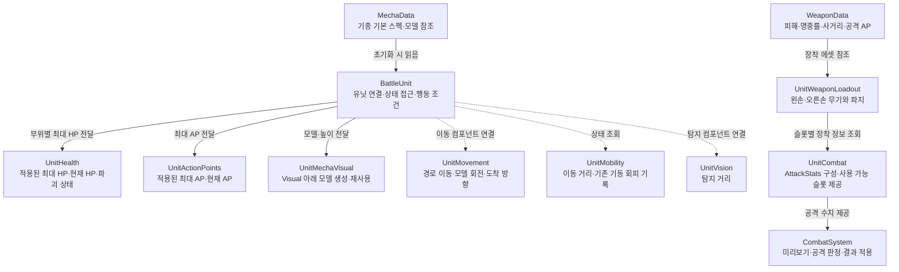
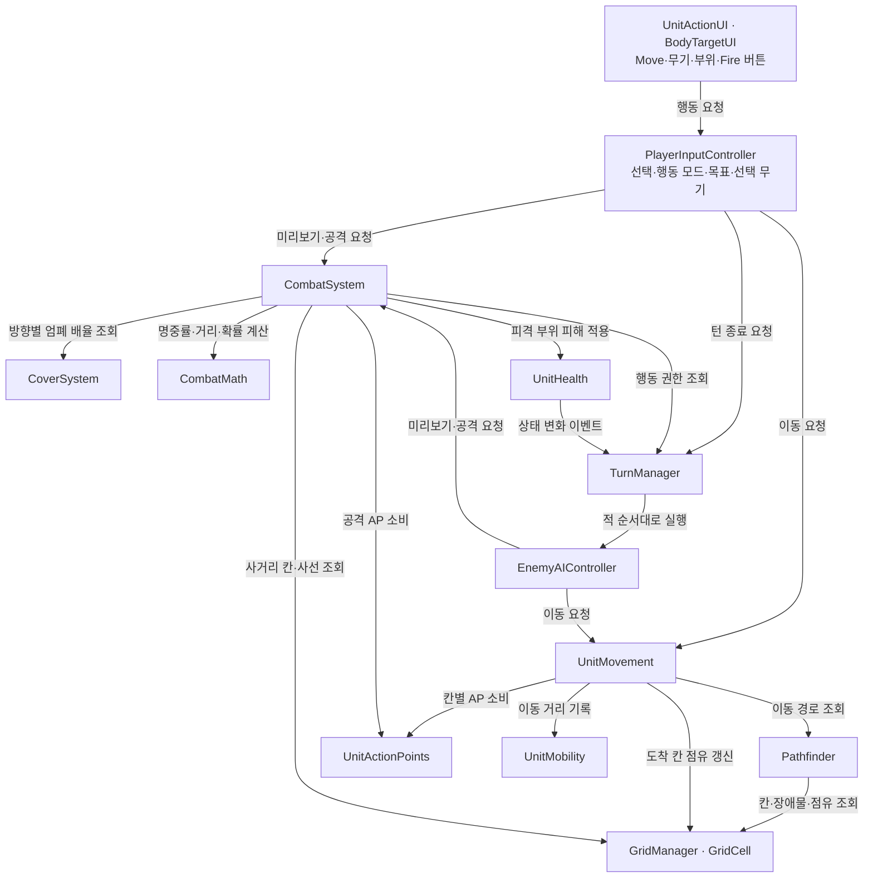
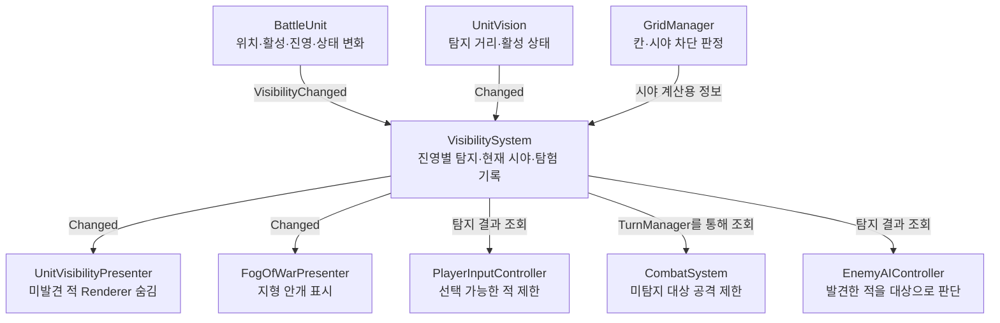
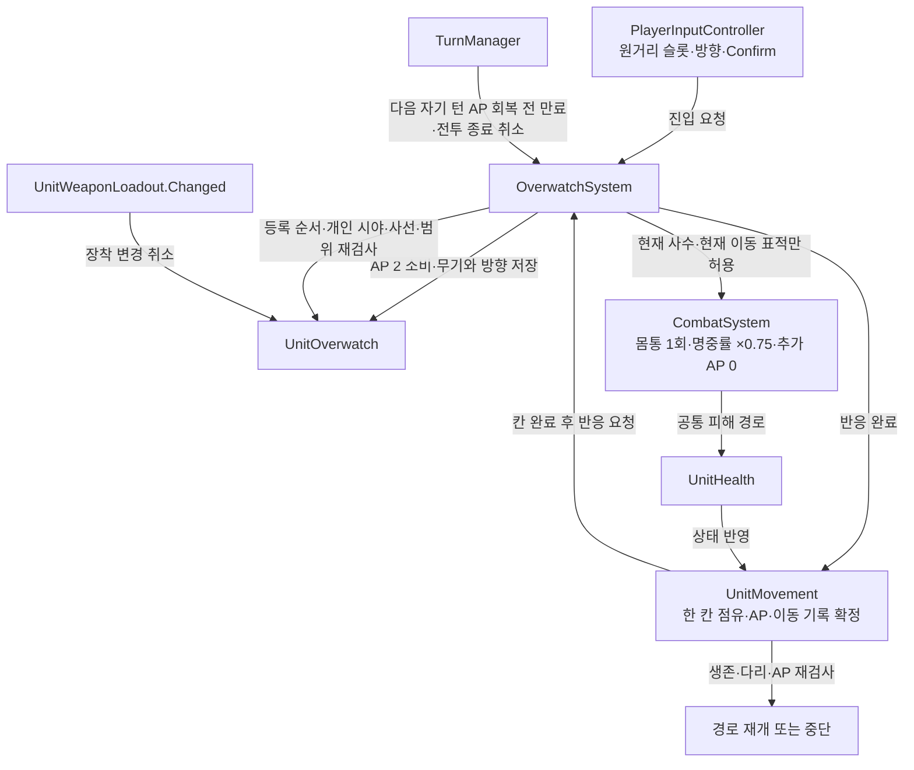

# 현재 코드 아키텍처

현재 구현의 주요 초기화·호출·데이터 전달 흐름을 정리했다. 화살표는 용도를 라벨로 구분하며, 모든 필드 참조나 역방향 상태 조회를 표시한 UML 클래스 다이어그램은 아니다.

## 1. 기체·무기 데이터와 유닛

- 같은 기종 여러 기체가 MechaData를 공유해도 현재 HP·AP는 각 유닛 컴포넌트가 독립적으로 보관한다.
- BattleUnit은 MechaData를 읽어 최대값을 전달한다. UnitHealth와 UnitActionPoints는 MechaData를 직접 참조하지 않는다.
- UnitMechaVisual도 MechaData를 직접 참조하지 않고 모델 프리팹과 높이만 전달받는다.
- UnitCombat은 공격 실행기가 아니다. 장착 무기 정보를 AttackStats로 제공하고 실제 명중·피해 처리는 CombatSystem이 수행한다.
- BattleUnit에는 컴포넌트 연결 외에도 다리 손상 이동 범위, 머리 손상 명중 배율, 행동 가능 조건 등 일부 유닛 규칙이 있다.

## 2. 행동 요청과 전투 처리

UI는 PlayerInputController의 상태를 읽어 표시하기도 한다. GridVisualizer는 선택·이동·공격·경계 범위·활성 적 표시를 담당하며, BattleDebugUI와 BodyTargetUI는 현재 상태와 공격 미리보기를 표시한다.

공격 예시:

1. UnitActionUI의 무기 버튼이 PlayerInputController.BeginWeaponAttack을 요청한다.
2. 적·부위 선택 후 CombatSystem.GetWeaponPreview로 조건과 명중률 등을 조회한다.
3. Fire를 누르면 CombatSystem.TryAttackWithWeapon을 호출한다.
4. 선택 슬롯·진영 턴·AP·탐지·사거리·사선 등을 다시 검사한다.
5. AP를 소비하고 명중을 판정한다. 명중하면 무기 범위 안에서 피해를 결정해 목표 UnitHealth에 적용한다.
6. 기체 상태 변화가 BattleUnit과 TurnManager에 전달되어 이동 취소·모델 숨김·점유 해제·전투 종료 등을 처리한다.

## 3. 시야와 화면 표시

VisibilitySystem은 유닛의 탐지 거리와 그리드의 시야 차단 규칙으로 진영별 시야를 계산한다. 표시 담당 컴포넌트들이 Changed 이벤트에 반응한다. BattleCameraOrbit은 이동·회전·줌·유닛 중심 이동을 담당한다.

## 4. 전투 시작 시 연결 순서

BattleSceneController.InitializeBattle이 전체 연결을 시작한다.

1. GridManager가 그리드를 생성한다. 카메라 기준을 초기화하고 장애물과 엄폐를 등록한다.
2. 각 BattleUnit.Initialize가 데이터 검증, 그리드 배치, HP·AP 초기화, 외형 준비, 이동 컴포넌트 초기화를 수행한다.
3. VisibilitySystem과 UnitVisibilityPresenter를 초기화한다.
4. CombatSystem과 EnemyAIController에 그리드·엄폐·턴 시스템을 연결하고, OverwatchSystem에 유닛·이동·공격·턴 처리를 연결한다.
5. TurnManager를 초기화하고 플레이어 진영 턴을 시작한다.
6. 전장의 안개, 그리드 표시, 입력·행동 UI·디버그 UI를 연결한다.

BattleSceneController는 전체 전투의 초기 연결을, BattleUnit은 개별 기체의 초기 연결을 담당한다. 반복 초기화가 기존 피해나 소비 AP를 회복시키지 않도록 초기화 가드가 있다.

## 5. 데이터 연결의 현재 범위

| 항목 | 현재 출처·처리 |
|---|---|
| 기체 최대 HP·기본 AP·모델 | MechaData → BattleUnit → 각 컴포넌트 |
| 현재 HP·AP·손상 | 유닛별 UnitHealth·UnitActionPoints |
| 무기 피해·기본 명중률·사거리·공격 AP | WeaponData → UnitWeaponLoadout → UnitCombat → CombatSystem |
| 이동 범위·다리 손상 이동 제한 | BattleUnit |
| 이동·회전 속도 | UnitMovement |
| 기동 회피 | UnitMobility에 기존 기록만 유지. 공격 명중률에는 미적용 |
| 경계 무기·방향·남은 1회 | 유닛별 UnitOverwatch |
| 경계 진입 AP 2·개인 감시 범위·반응 순서 | OverwatchSystem |
| 반응 명중률 ×0.75·몸통 피해 | OverwatchSystem의 권한 검사 → CombatSystem 공통 계산·피해 처리 |
| 탐지 거리 | UnitVision 자체 설정. 아직 MechaData 항목과 연결하지 않음 |
| AP당 이동거리·기체 중량·장착 한도 | MechaData에 저장만 함. 이동 비용·중량 제한에 미적용 |
| 데이터 없는 유닛 | 기존 HP·AP 컴포넌트 설정으로 초기화 |

## 6. 경계사격과 이동 재개

일반 공격은 자신의 진영 턴·AP·행동 가능 조건을 그대로 검사한다. 반응 공격은 OverwatchSystem이 현재 처리 중인 칸 완료와 사수·표적 조합을 승인해야 실행할 수 있다. 일반 공격의 권한을 포괄적으로 완화하지 않는다.

UnitOverwatch는 무기·파지·방향·진입 위치와 유효 상태를 관리하고, OverwatchSystem은 비용·범위·발동 순서를 담당한다. 발사 전에 경계 1회를 소비하므로 명중과 빗나감 모두 재발사하지 않는다. 이동 취소·비활성화·전투 종료 시 처리 중 참조와 잠금을 정리한다. 반응 처리 중에는 턴 종료와 새 행동을 제한한다.

기동 회피는 명중률에서 제외했다. 파일럿 CharacterData와 패시브 인터페이스는 정의되어 있지만 전투 계산에는 아직 연결하지 않았다. 자세한 규칙은 [경계사격 안내](overwatch-guide.ko.md)를 참고한다.

## 주요 소스 위치

- 전체 초기화: `Assets/_Game/Scripts/Setup/BattleSceneController.cs`
- 기체 연결: `Assets/_Game/Scripts/Unit/BattleUnit.cs`
- 기체 기본 데이터: `Assets/_Game/Scripts/Unit/MechaData.cs`
- 무기 기본 데이터: `Assets/_Game/Scripts/Combat/WeaponData.cs`
- 장착과 공격 수치: `Assets/_Game/Scripts/Unit/UnitWeaponLoadout.cs`, `UnitCombat.cs`
- 공격 판정: `Assets/_Game/Scripts/Combat/CombatSystem.cs`, `CombatMath.cs`
- 경계: `Assets/_Game/Scripts/Combat/OverwatchSystem.cs`, `OverwatchMath.cs`, `Assets/_Game/Scripts/Unit/UnitOverwatch.cs`
- 턴·적 판단: `Assets/_Game/Scripts/Turn/TurnManager.cs`, `Assets/_Game/Scripts/AI/EnemyAIController.cs`
- 탐지: `Assets/_Game/Scripts/Battle/VisibilitySystem.cs`
- 입력: `Assets/_Game/Scripts/Input/PlayerInputController.cs`
- 표시: `Assets/_Game/Scripts/Presentation/`
